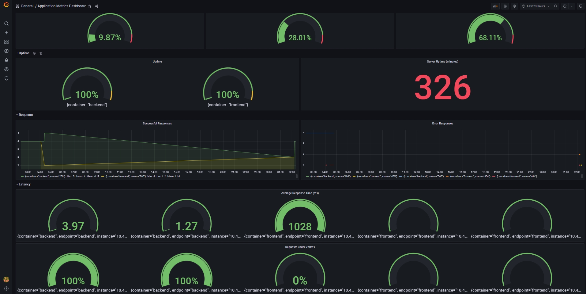
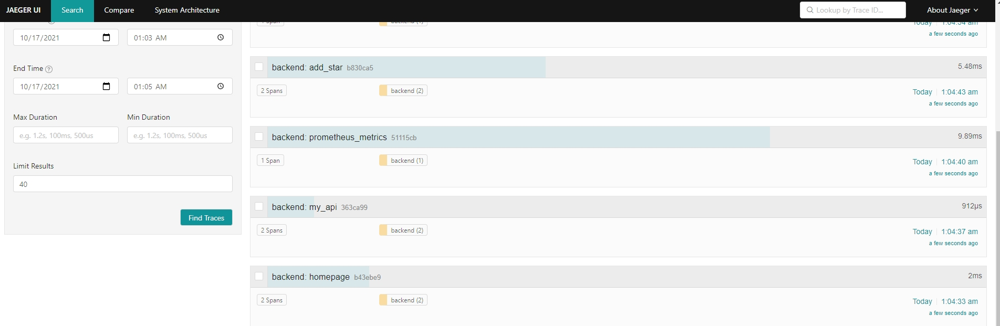
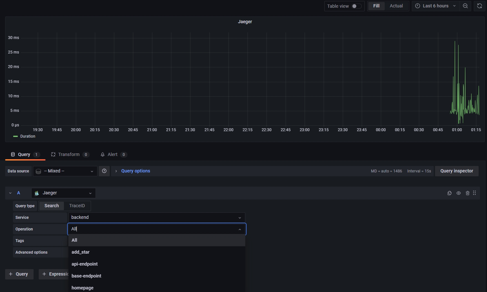

# Observability Stack: Prometheus, Grafana and Jaeger on Kubernetes

Instrumented three Flask microservices running on Kubernetes with Prometheus metrics and Jaeger distributed tracing, then defined SLOs/SLIs and built a Grafana dashboard to track them. Includes a sample incident ticket raised from what the dashboards showed.

   

## What's in the cluster

| Component | How it's deployed |
|-----------|-------------------|
| Prometheus + Grafana | `kube-prometheus-stack` Helm chart in the `monitoring` namespace |
| Jaeger | Jaeger Operator + custom instance (`manifests/jaeger-custom/`) in the `observability` namespace |
| Frontend app (Flask) | `manifests/app/frontend.yaml`, port 8080 |
| Backend app (Flask + MongoDB) | `manifests/app/backend.yaml`, port 8081 |
| Trial app (Flask) | `manifests/app/trial.yaml`, port 8082 |

Each app exposes request metrics through `prometheus-flask-exporter` (Gunicorn multiprocess mode) and is picked up by a `ServiceMonitor`. The backend and trial apps send spans to Jaeger via `jaeger-client`/OpenTracing and OpenTelemetry, with a span per endpoint and tags for results and errors.

## SLOs and SLIs

Example service-level objective for a SaaS product: **99% monthly uptime, and 90% of monthly requests served in under 200 ms.**

SLIs used to measure it:

1. **Uptime**: percentage of the month the service was fully operational.
2. **Latency**: time from request to response, in ms.
3. **Error rate**: failed requests per month (errors eat into uptime).
4. **Saturation**: CPU, memory and disk utilization; a maxed-out resource degrades latency and leads to failures.
5. **Traffic**: HTTP requests per second, to see how close the system is to its limits.

Target SLOs for this stack:

- Application uptime of 99.95% per month
- More than 99% of monthly requests succeed without errors
- Server resources stay below 90% utilization
- 90% of monthly requests respond within 1500 ms

KPIs tracked on the final dashboard: CPU, memory and disk utilization < 90%; successful responses > 99.9%; error responses < 0.1%; deployment uptime > 99.95%; server uptime; average response time < 250 ms; share of requests under 250 ms > 90%.

## Final dashboard



| Panel | Shows |
|-------|-------|
| Drive / CPU / Memory usage | Current resource utilization |
| Successful responses | Successful requests per month, by container |
| Error responses | Failed requests per month, by container and status code |
| Uptime | Uptime of the frontend and backend services |
| Server uptime | Minutes since the node booted |
| Average response time | Average latency of successful requests over 1-hour windows, per path |
| Requests under 250 ms | Percentage of successful requests finishing within 250 ms, per path |

A Grafana-importable reference dashboard is in [`reference-dashboards/`](reference-dashboards/).

## Tracing



Jaeger is also added as a Grafana data source so traces can be viewed next to metrics:



## Incident ticket raised from the dashboards

> **500 Server Error on the backend `/star` endpoint**
> **Date:** 16 Oct 2021 · **Severity:** High · **Affected area:** backend `/star` API
> The endpoint accepts POST requests but cannot reach MongoDB, either because the database does not exist or the connection string is misconfigured. Spotted from the error-rate panel and confirmed with the failing span in Jaeger.

## Run it

```bash
# 1. VM with k3s
vagrant up && vagrant ssh
sh k3s.sh                     # or install k3s manually

# 2. Monitoring
kubectl create namespace monitoring
helm repo add prometheus-community https://prometheus-community.github.io/helm-charts
helm install prometheus prometheus-community/kube-prometheus-stack -n monitoring

# 3. Tracing
kubectl create namespace observability
kubectl apply -f manifests/jaeger-custom/

# 4. Applications
kubectl apply -f manifests/app/

# 5. Grafana (default admin / prom-operator)
kubectl port-forward -n monitoring svc/prometheus-grafana 3000:80
```

Images are on Docker Hub as `rkhudoyberdiev/frontend-app`, `rkhudoyberdiev/backend-app` and `rkhudoyberdiev/trial-app`. Source for each is in [`reference-app/`](reference-app/).

## Screenshots

All monitoring components running, Prometheus data source, health report and more are in [`answer-img/`](answer-img/).

---

Built as part of the Udacity Cloud Native Application Architecture Nanodegree. Author: Ravshan Khudoyberdiev.
